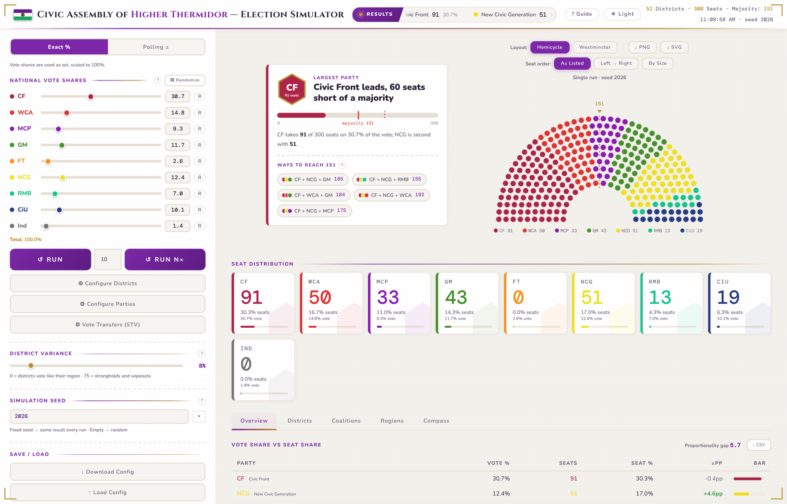

# CAHT Election Simulator

An election simulator built for the Civic Assembly of [Higher Thermidor](https://www.nationstates.net/nation=higher_thermidor), a nation on NationStates. Set it up for your own country, with your parties, districts, regions and electoral system, or load a real one: Spain, the United Kingdom, the United States, Australia, Canada, Ireland, the Netherlands, Germany, Portugal or New Zealand, each starting from its last election.

[**Open the simulator**](https://consuldelmar.github.io/ThermidorElections/) · [**Read the guide on NationStates**](https://www.nationstates.net/page=dispatch/id=2823704)

## What it does

* Counts each district by one of five electoral systems: the single transferable vote (STV, with a Droop quota), first past the post, the D'Hondt and Sainte-Laguë party-list methods with an optional threshold, or an electoral college for presidential elections. With one seat per district, STV works as the alternative vote.
* In presidential mode, shows a tile map of the states, the race to a majority of electors, the popular vote, the tipping-point state, the closest contests and the states that flipped, and after many runs each candidate's chance of winning.
* Loads real countries with their parties, districts and each district's result at the last election, so a first run comes out at or close to that election. When you change a party's vote, every district moves by the same proportion.
* Moves STV transfers by how close parties sit on a two-axis political compass, or by a transfer table you edit yourself.
* Offers a third way to set the vote, Scenario: start from the last election, choose who governs and the economic conditions, add events (corruption cases, scandals, new leaders, infighting, campaigns, endorsements, defections, unpopular laws, popular measures, wars, terror attacks, natural disasters and pandemics, government infighting, shifts in the national mood, an issue in the spotlight, protest movements, splinters, new parties, joint lists and mergers, parties sitting out), and the vote follows. Event sizes follow published research where it exists, and a voter fluidity setting scales everything down for polarised countries or up for fluid ones. Each event's effect is a likely range rather than a fixed number, drawn anew in every run, and the result before the run shows each party's most likely figure and where 8 in 10 runs land. The last election it starts from can be set by hand, for made-up countries or to try a different past. Governing parties pay the cost of ruling, junior partners lose more, lost votes go partly to anti-establishment parties and the rest to compass neighbours, and splinters are strongest where their parent party is.
* Uses vote shares exactly as set, treats them as polls and draws results around them (with optional momentum trends), or builds them from a scenario. Regional swing moves all the districts of a region together, the way real polling misses do.
* Runs one election or up to 1,000, showing the median parliament and how much each party's seats vary.
* Lets you build coalitions, see the ways to reach a majority, and share out ministerial posts.
* Shows the chamber as a hemicycle or Westminster benches, with district, regional and compass views.
* Exports the chamber as PNG or SVG and the results as CSV, and saves the whole setup as a JSON file.

The guide on NationStates explains every option in detail.

## Using it

Open the link above, or download `index.html` and open it in any modern browser. It's a single file with nothing to install. It needs an internet connection only for its fonts.

The **Country** menu reads the files in [`presets/`](presets/), so it only works on the published site. If you open `index.html` from your own computer, load a country with **Load Config** instead, using a file from `presets/`.

To start from a ready-made setup of your own, download a file from [`examples/`](examples/) and open it with **Load Config**:

* `higher-thermidor.json` is the default model: 9 parties, 10 provinces, 52 districts and 300 seats.
* `example-republic.json` is a small fictional country with 6 parties, 4 regions and 101 seats, a simple base for building your own.

Keyboard shortcuts: **R** or **Enter** runs one election, **N** runs the batch, and **Esc** closes an editor without keeping its changes.

## Real countries

| Country | Election | System | Seats |
|---|---|---|---|
| Spain | 2023 | D'Hondt in 52 provinces, 3% threshold | 350 |
| United Kingdom | 2024 | First past the post, 650 constituencies | 650 |
| United States | 2024 | Electoral college: 50 states, DC, and Maine's and Nebraska's districts | 538 electors |
| Australia | 2025 | Preferential voting, 150 divisions | 150 |
| Canada | 2025 | First past the post, 343 ridings | 343 |
| Ireland | 2024 | STV, 43 constituencies | 174 |
| Netherlands | 2025 | D'Hondt, one nationwide district, 0.67% threshold | 150 |
| Germany | 2025 | Sainte-Laguë in 16 states, 5% nationwide threshold | 630 |
| Portugal | 2025 | D'Hondt in 22 constituencies | 230 |
| New Zealand | 2023 | Sainte-Laguë on the party vote | 120 |

Each file records its sources and simplifications in its `source` and `notes` fields. In short:

* Vote shares are among the parties that won seats, so small parties and blank votes are left out. Australia, Ireland and Germany also keep an "other" group, because there small parties' votes change the result.
* Compass positions are estimates on the scales of the Chapel Hill Expert Survey, except Spain's, which were set by the authors.
* A few rules the app can't express are left out, such as Germany's exemption for the Danish minority and New Zealand's electorate seats and overhang.

To add a country, save any setup with **Download Config**, put the file in `presets/`, and add a line for it to `presets/index.json`.

## Credits and license

Created by F. Puyó, Consuldelmar and JuliaCerezo.

The code is released under the [MIT License](LICENSE). The flag of Higher Thermidor and its default dataset belong to the authors' NationStates worldbuilding and are included as an example; if you publish your own version, please replace them with your country's. The election results in `presets/` come from official sources, cited in each file.
